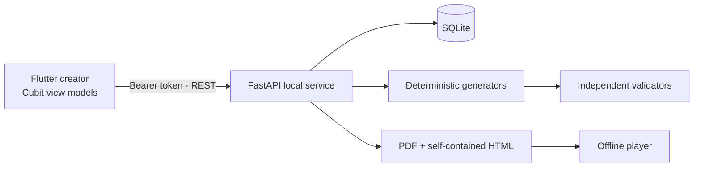

# PuzzleMint

PuzzleMint is a local-first creator for personalized puzzle adventures. The Flutter creator and Python API are developed in runnable increments. The app can create drafts, generate four puzzle families, validate them, and export printable or offline games.

## Requirements

- Flutter 3.41.2 or newer compatible stable version
- Python 3.12 or newer
- Windows for the primary desktop target

All dependencies are free. The core product does not require a cloud account or paid API.

## Run locally

From the repository root:

```powershell
python -m venv .venv
.\.venv\Scripts\python -m pip install -r backend\requirements-dev.txt
.\.venv\Scripts\python -m alembic -c backend\alembic.ini upgrade head
.\.venv\Scripts\python backend\run.py
```

The backend prints a new session token on startup and binds to `127.0.0.1:8765`. Paste the token into the Flutter connection screen. API clients send it in `Authorization: Bearer <token>`. The API has no CORS origins enabled. The token is held in memory and is never committed to source control. Keep the API terminal open while using the creator.

In another terminal:

```powershell
flutter pub get
flutter run -d windows
```

The API uses `backend/puzzlemint.db` by default. Set `PUZZLEMINT_DATABASE_URL` to another SQLite URL when needed. Run Alembic migrations before starting a new database.

## Verify

```powershell
python -m pytest backend\tests -q
flutter test
flutter analyze
```

## Current architecture

- Flutter desktop creator, with Android and web project scaffolds for later adaptation.
- FastAPI versioned local API with Pydantic input validation and a per-run bearer token.
- SQLAlchemy relational models, SQLite foreign keys, and Alembic migration.
- Separate project and personalization records; puzzle, dependency, hint, validation, and export tables are ready for the next increments.
- Deterministic Caesar ciphers, three-digit locks, small logic grids, and exact-order timelines. Lock combinations, logic assignments, and timeline orders are enumerated independently to check uniqueness. A chain of dependencies connects the stages.
- PDF player handout and separate organizer answer key; self-contained HTML player with hints, answer checks, stage unlocks, and browser-local progress where available. Export text is encoded into JSON and rendered through safe DOM text APIs. Offline answers can be inspected by a technically skilled player.
- The creator has a seven-step wizard, saved drafts, search and status filters, sample-game generation, a puzzle inspector, validation reports, duplication, deletion, and export actions.

## Platform notes

The Windows desktop app needs Flutter's Windows build toolchain (Visual Studio with Desktop development with C++). `flutter analyze`, `flutter test`, and `flutter build web` were verified in the development environment; `flutter build windows` could not run there because that toolchain is absent. For local web development, explicitly allow one origin before starting the backend, then run Flutter on that port:

```powershell
$env:PUZZLEMINT_CORS_ORIGINS='http://localhost:8766,http://127.0.0.1:8766'
python backend\run.py
# In a second terminal:
flutter run -d chrome --web-port=8766
```

The self-contained exported HTML game does not use the API and runs offline. Open `backend/exports/<project-id>/adventure.html` in a desktop browser. Some mobile browsers restrict local files; transfer it as a file or host it as a static asset in a trusted local environment.

## Demonstration

Choose **Create sample adventure** on the dashboard. This creates *The Midnight Museum* for Aarav with a birthday theme, six actual generated puzzles, a 30-minute target, a validated dependency chain, and a Star Diamond ending. The sample uses the same generator and validator as every other adventure. Export produces:

- `adventure.html`: offline interactive game with progressive hints, answer feedback, local progress, and a personalized ending.
- `player-handout.pdf`: printable puzzle pages and completion message.
- `organizer-answer-key.pdf`: separate answers and hints.

The creator can edit a puzzle's title and story, replace a puzzle, revalidate, and attempt bounded repair for an invalid puzzle. Exports are gated on successful validation.

## Architecture



The Flutter data repository owns HTTP calls. Cubits own loading, success, and error states. Widgets present state and gather input. Pydantic checks API inputs; SQLAlchemy models persist relational data. The generator builds content from a seed, while independent enumeration checks puzzle correctness. The exported player contains all assets and logic in one file.

## Generation and validation

- **Cipher:** choose a target word, encode with a seeded Caesar shift, then independently decode and compare with the target.
- **Number lock:** choose three digits and derive sum and difference clues. Enumerate all 900 three-digit possibilities to prove the answer is unique.
- **Logic grid:** assign three people to three objects and places, select consistent clues, then enumerate all 36 possible full assignments to prove uniqueness.
- **Sequence:** create a four-event order and prerequisite edges, then enumerate valid orders to prove there is exactly one.
- **Adventure graph:** each chamber requires the previous chamber. Validation checks puzzle IDs, missing prerequisites, cycles, and whether every mandatory stage can become reachable. Generated status alone never unlocks export.
- **Presentation checks:** hints are recalculated from the actual clue data; number-lock text must state the real equations; story text cannot reveal its chamber's answer in advance.
- **Repair:** retry at most three deterministic candidates for each invalid puzzle, preserve other puzzles, then revalidate the whole adventure. Dependency graph defects require creator intervention.

The API exposes `/api/v1/projects` CRUD, `/generate`, `/validate`, `/repair`, `/preview`, `/quality`, `/puzzles`, `/duplicate`, `/export/html`, `/export/pdf`, puzzle edit/regenerate, and authenticated export downloads. A successful validation run and its errors are stored in `validation_runs`.

## Performance measurement

Run `python backend/benchmark.py` from the repository root. One CPU-only run on the development machine (30 seeds each, generation plus independent validation, October 2026) measured:

| Puzzles | Median | p95 | Max |
| --- | ---: | ---: | ---: |
| 4 | 1.8 ms | 3.9 ms | 4.7 ms |
| 6 | 2.3 ms | 4.3 ms | 5.1 ms |
| 8 | 4.4 ms | 6.6 ms | 6.9 ms |

These are local measurements, not device-independent performance guarantees. PDF creation, database writes, and UI rendering are excluded.

## Privacy and security

The API binds to `127.0.0.1`, requires a random token per backend run, limits request bodies to 64 KiB, and disables cross-origin browser access unless exact origins are configured. Text is escaped in PDF output and encoded safely in the HTML data script; the player uses DOM text APIs instead of injecting HTML. Export filenames are controlled by the server and downloaded paths are checked against the export root. There is no telemetry, cloud inference, account, or payment collection. Local storage and the SQLite file are visible to someone with access to this computer. The session token is displayed in the backend terminal so the Flutter app can connect; do not share that terminal output.

## Dependencies and licensing

Flutter uses `flutter_bloc` (MIT), `dio` (MIT), `get_it` (MIT), and `go_router` (BSD-style Flutter license). The backend uses FastAPI (MIT), Uvicorn (BSD-3-Clause), Pydantic (MIT), SQLAlchemy (MIT), Alembic (MIT), and ReportLab (BSD-style). Tests use pytest (MIT), HTTPX (BSD-3-Clause), and pypdf (BSD-3-Clause). Exact resolved versions are in `pubspec.lock` and Python requirement ranges are in `backend/requirements*.txt`. Review the bundled license files before distributing a packaged product. This repository has no project license yet; choose one before public redistribution.

## Known limits and next work

- A Windows release package has not been built because this machine lacks the C++ toolchain. Android uses a separate localhost and needs a local-service connection strategy before creator use.
- Ollama story enrichment is not integrated. The deterministic core works without it.
- The graph inspector supports a linear chain and puzzle replacement. General branching, dependency editing, and semantic analysis of freeform story edits are future work.
- Logic puzzles use three people and a small clue set; number locks use one algebraic template. Add larger templates only with bounded solvers and validation.
- The offline HTML game was inspected through generated output and API tests; this environment's browser tool blocks direct `file://` navigation, so manual browser completion of that file remains a release check.
- No payment gateway, orders workflow, automated Windows packaging, or market price validation is included.
